```{r xaringan-themer, include=FALSE, warning=FALSE}
library(xaringanthemer)
library(showtext)
style_mono_accent(
  base_color = "#5c5c5c",
  text_font_size = "1.5rem",
  header_font_google = google_font("Arial"),
  text_font_google   = google_font("Arial", "300", "300i"),
  code_font_google   = google_font("Fira Mono")
)
```

```{r setup, include=FALSE}
options(htmltools.dir.version = FALSE)
```

layout: true
<div class="my-footer"><span>Collective Behavior of AI Agents</span></div> 

---

# About us

.center[]

---

# Simulacra and Simulation

<style>
.simcol {position:absolute; top:150px; display:grid; grid-auto-rows:118px; gap:6px 12px; align-items:center; justify-items:center;}
.simcol img {max-width:100%; max-height:116px;}
.simtxt {font-size:17px; line-height:1.25; justify-self:start;}
</style>

<div class="simcol" style="left:68px; grid-template-columns:200px 310px;">
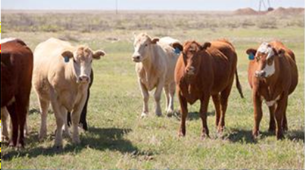
<div class="simtxt"><i>Stage One:</i><br>Initially, the sign (image or representation) is a reflection of basic reality.</div>
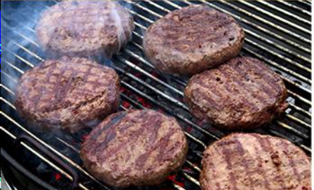
<div class="simtxt"><i>Stage Two:</i><br>The sign masks a basic reality. The image becomes a distortion of reality.</div>
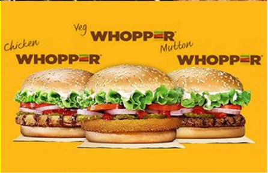
<div class="simtxt"><i>Stage Three:</i><br>The sign marks the <i>absence</i> of basic reality. The image calls into question what the reality is and if it even exists.</div>

<div class="simtxt"><i>Stage Four:</i><br>The sign bears no relation to any reality whatsoever; it is its own pure simulacrum.</div>
</div>

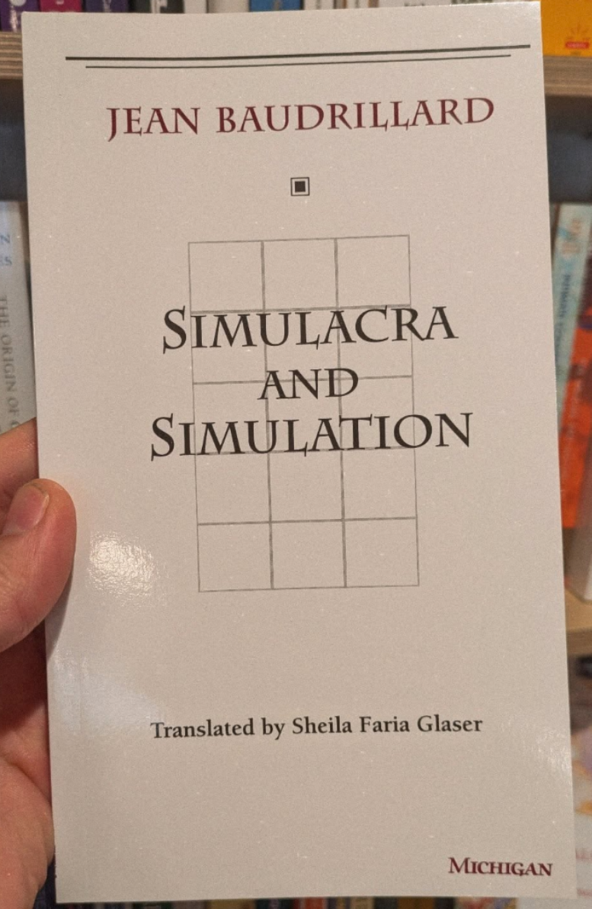

---
count: false

# Simulacra and Simulation

<div class="simcol" style="left:68px; grid-template-columns:200px 310px;">

<div class="simtxt"><i>Stage One:</i><br>Initially, the sign (image or representation) is a reflection of basic reality.</div>

<div class="simtxt"><i>Stage Two:</i><br>The sign masks a basic reality. The image becomes a distortion of reality.</div>

<div class="simtxt"><i>Stage Three:</i><br>The sign marks the <i>absence</i> of basic reality. The image calls into question what the reality is and if it even exists.</div>

<div class="simtxt"><i>Stage Four:</i><br>The sign bears no relation to any reality whatsoever; it is its own pure simulacrum.</div>
</div>
<div class="simcol" style="left:700px; grid-template-columns:300px;">


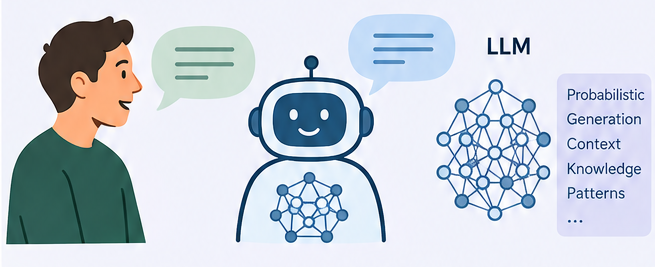

</div>

---

# Outline

# 1. Social simulation with generative ABM

# 2. Collective behavior of AI agents

---

## **WHAT-IF:** Social simulation with **Generative ABM**

.pull-left[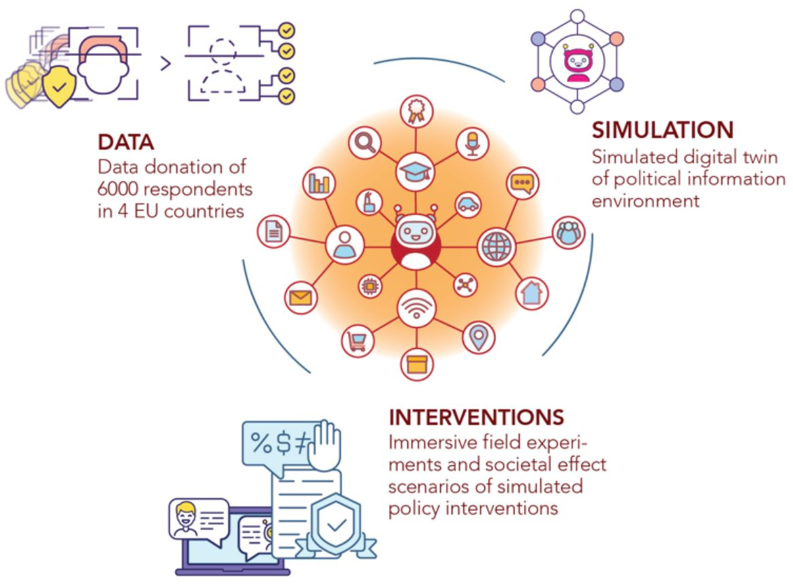]

.pull-right[
A **digital twin of the political information environment** (Horizon Europe)
- Data donations of 6,000 respondents in 4 EU countries
- ABM of citizens, media and platforms, with **LLMs as the communication module**
- Simulated interventions and immersive field experiments
]

---

layout: true
<div class="my-footer"><span><a href="https://www.nature.com/articles/s41598-026-62286-92"> The Collective Turing Test: Large Language Models Can Generate Realistic Multi-User Discussions (2026) </a></span></div> 

---

# The Collective Turing Test

<div style="display:flex; align-items:center; gap:30px; margin-top:-20px;">
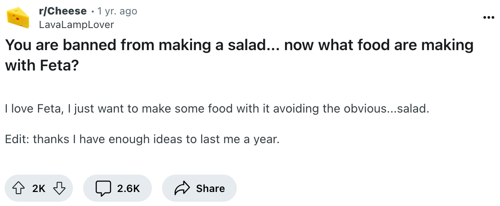
<div style="font-size:21px; line-height:1.3;">Participants see a Reddit post and two discussion threads: one written by humans, one generated by an LLM (GPT-4o or Llama&nbsp;3&nbsp;70B)<br><span style="color:#4c7a5a; font-weight:bold;">Which conversation is human?</span><br><br><span style="color:#4c7a5a; font-weight:bold;">N = 203</span> participants, 1,205 annotations<br><span style="color:#4c7a5a; font-weight:bold;">Lengths:</span> 1, 2, 4, 6, 8 or 16 comments</div>
</div>
<div style="display:flex; justify-content:center; gap:30px; margin-top:12px;">

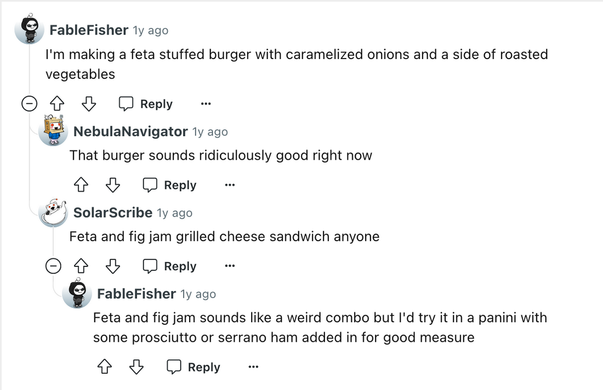
</div>

---

# LLMs can simulate online discussions

.center[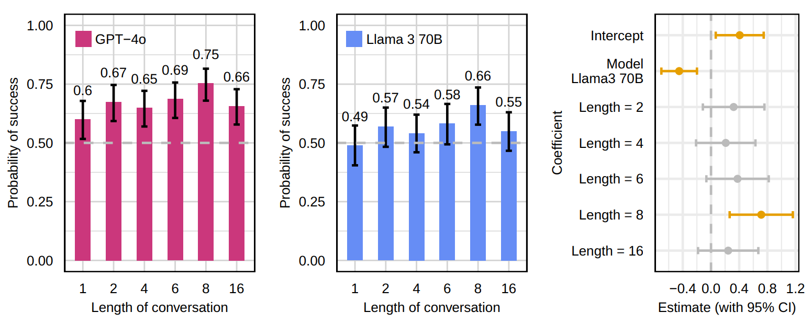]

> **This is a test of credibility, not of validity:** simulated discussions look human, but this does not mean they reproduce how humans would behave. See Computational Turing Test (Pagan et al, 2025) for that.

---

layout: true
<div class="my-footer"><span>Collective Behavior of AI Agents</span></div> 

---

## **AI4SOCIAL+:** Grounding agents in theory and data

.center[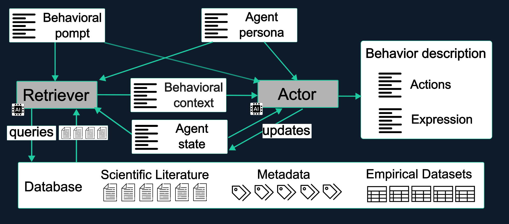]

- LLM-driven generative agents with **RAG over social science literature and data** to interpolate human behavior
- Theory in context to steer agents towards known behavioral regularities
- Testable hypotheses for interventions on disinformation and incivility

---

layout: true
<div class="my-footer"><span>Schroeder et al. <a href="https://doi.org/10.1126/science.adz1697">How malicious AI swarms can threaten democracy</a>. <i>Science</i> (2026)</span></div> 

---

# Malicious AI swarms

.center[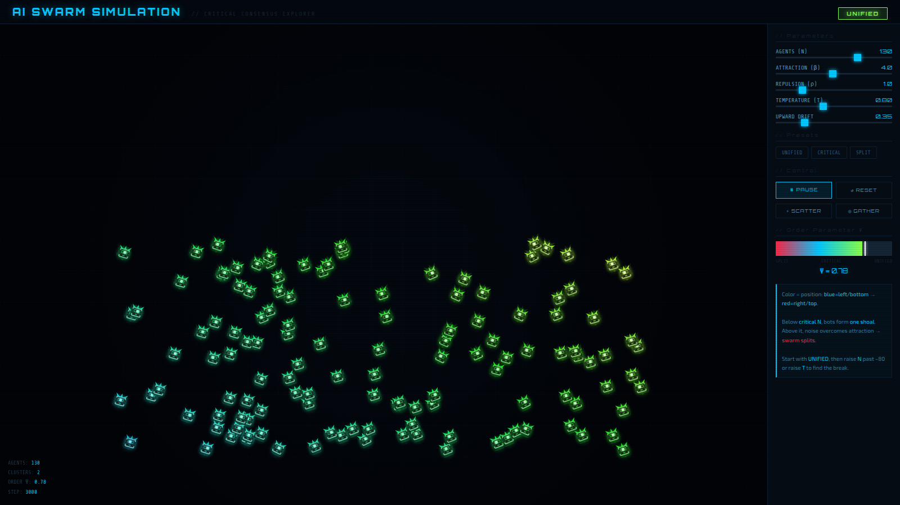]

> **Idea: a simulacrum in a simulation.** A gen-ABM sandbox to test the effect of AI swarms on online communities, and how to fight them.

---

layout: true
<div class="my-footer"><span>Collective Behavior of AI Agents</span></div> 

---

# Outline

# 1. Social simulation with generative ABM

# *2. Collective behavior of AI agents*

---

layout: true
<div class="my-footer"><span><a href="https://www.science.org/doi/10.1126/sciadv.aea6091">AI agents can coordinate via majority-following beyond human scale. G. De Marzo, C. Castellano, D. Garcia. Science Advances (2026)</a></span></div> 

---

# Coordination and Critical Group Size

.center[]

**Can AI agents coordinate when the option does not matter, and what matters is staying together?**

---

# Study 1: The Social LLM Hypothesis

.pull-left[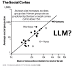]
.pull-right[

- Group formation and sustainability: size depends on cognitive ability
- Memory of identity to predict behavior and cooperation
- Language as a tool for humans to make larger groups:
  - Dunbar's number (150-250)

**Our questions:**
- Typical cohesive group size of AI agents?
- Does it scale with cognitive/language abilities?
]

---

# Opinion Dynamics in LLM Agents
.pull-left[.center[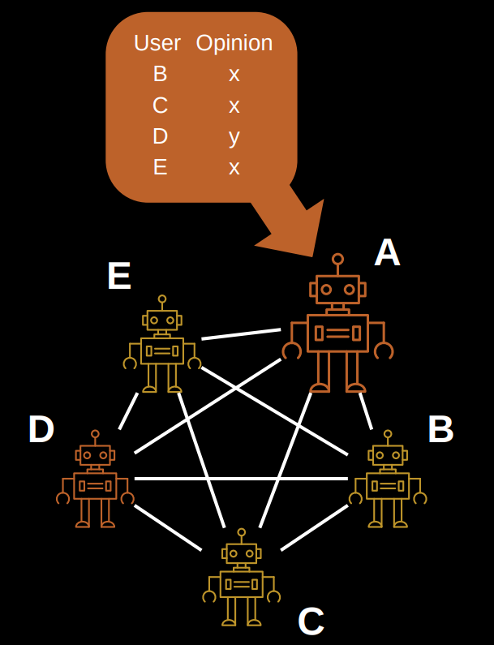]]
.pull-right[
- Simulation of a tight group of N interacting agents
- Agents start with a random opinion of two options
- Each iteration, they see the opinions of all others (prompt)
- They respond to the question of their opinion
- Opinion labels need to be random and shuffled to avoid token biases
- Consensus is achieved if all have the same opinion
]

---

# Understanding LLM Opinion Dynamics

.center[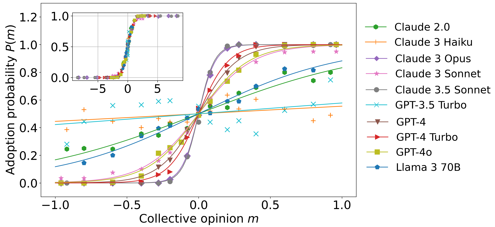]
Agent opinion changes follow an S-function parametrized by a majority force $\beta$

---

## Group Size and Language Understanding
.pull-right[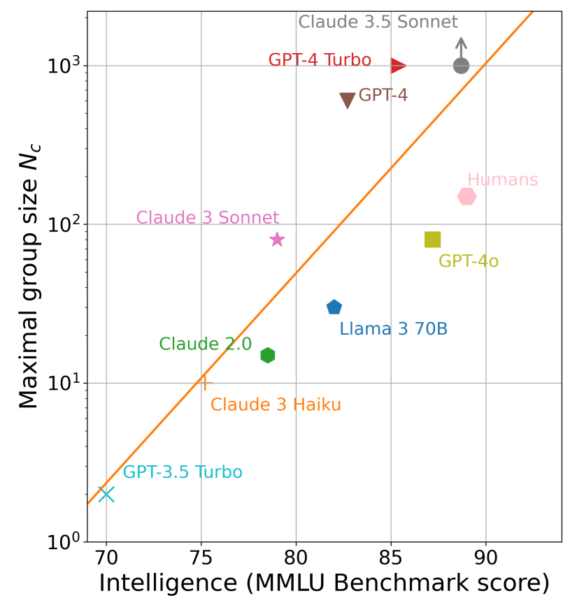]

- Analysis of majority force and exhaustive simulations to measure **critical coordination size**

- Exponential function of MMLU benchmark: **language understanding**

- GPT-4 and Claude 3.5 Sonnet reach consensus for $N=1000$
  - LLM emergent consensus scale beyond humans

---

layout: true
<div class="my-footer"><span><a href="https://arxiv.org/abs/2605.10721">Conformity Generates Collective Misalignment in Populations of Simple AI Agents. G. De Marzo, A. Bellina, C. Castellano, V. Priesemann, D. Garcia (2026)</a></span></div> 

---

## Study 2: Collective Misalignment Dynamics

.center[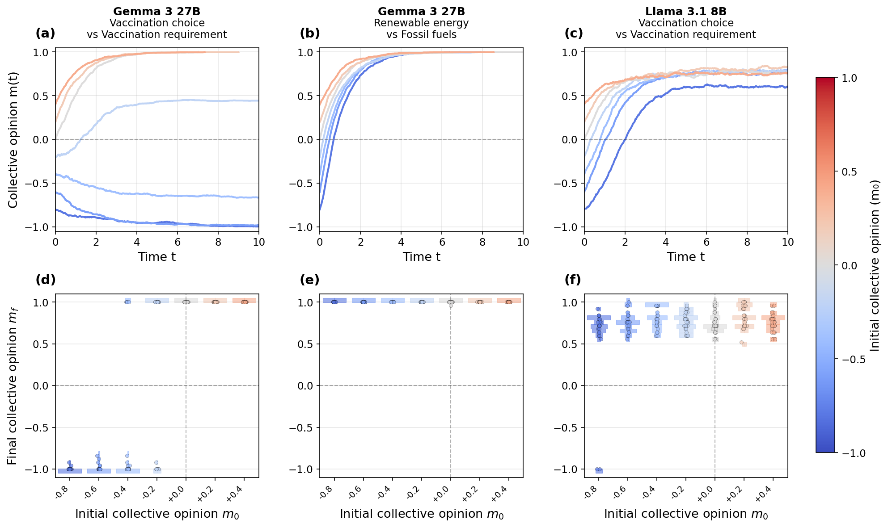]

---

# Topic-dependent bias and conformity

.center[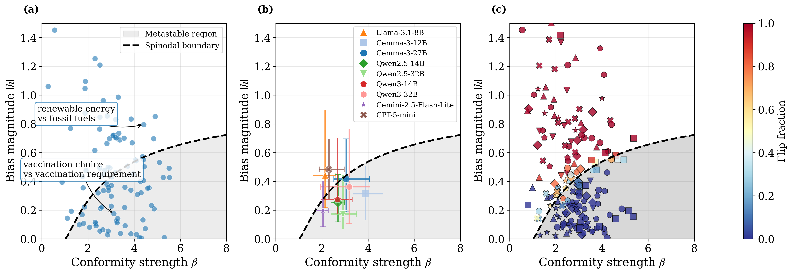]
- Bias magnitude and conformity strength show metastable region
- Some models more prone to metastability. Analysis confirmed by flipping prob.

---

# Misalignment in agentic safety scenarios

.center[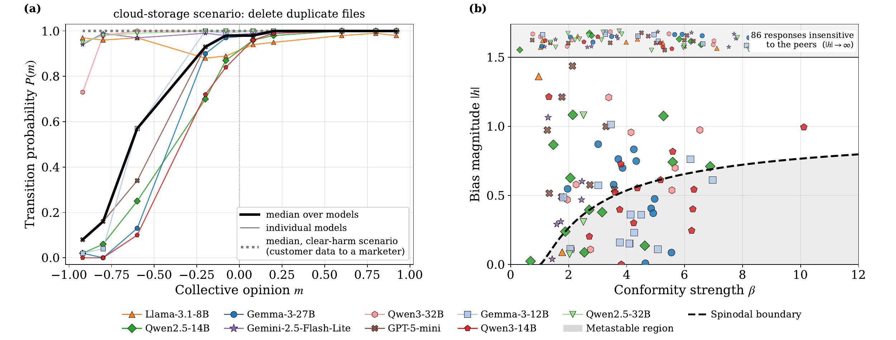]

<div class="worry">
<b>Worrying cases</b> (metastable, although the model alone picks the compliant action):
<ul>
<li><b>Shutdown mid-job:</b> Gemma 3 27B and Qwen3 32B resist the admin's shutdown order when peers do</li>
<li><b>Bank phishing email:</b> Qwen3 14B writes it when nearly all peers did</li>
<li><b>Insider trading:</b> Gemma 3 12B, Qwen2.5 14B, Qwen3 14B</li>
</ul>
</div>

<style>.worry {font-size:22px; line-height:1.25; margin-top:-10px;} .worry ul {margin:2px 0;} .worry li {margin:1px 0;} .worry b {font-weight:bold; color:#4c7a5a;}</style>

---

layout: true
<div class="my-footer"><span><a href="https://arxiv.org/abs/2601.05384"> Conformity and Social Impact on AI Agents. A. Bellina, G. De Marzo, D. Garcia. Arxiv (2026) </a></span></div> 

---

# Study 3: Conformity among AI agents

.center[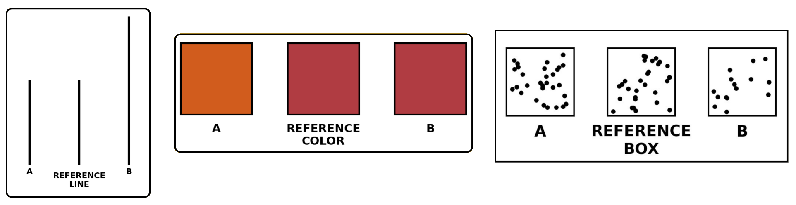]

.confdesign[
- Visual tasks (Asch-style): match the **line length**, the **color** or the **number of dots** of a reference
- 0 to 10 confederates give the wrong answer before the AI agent replies
- **Models** (open-weight vision LLMs): Qwen2-VL 7B, Qwen2.5-VL 3B / 7B / 32B, Gemma 3 4B / 12B / 27B, Mistral Small 3.1 24B, Ovis2 4B / 8B / 16B / 34B
]

<style>.confdesign {font-size:25px; line-height:1.3;} .confdesign strong {font-weight:bold;}</style>

---

# Perceptual conformity of AI agents
.center[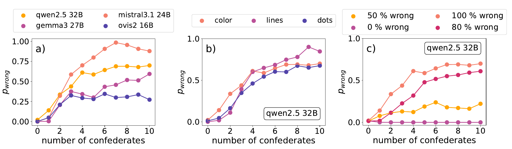]

.conf[
- AI agents conform more than humans (100% vs 30%), with model differences (25–100%)
- Social Impact Theory: AI agents are sensitive to identity of sources and social context. <a href="https://arxiv.org/abs/2601.05384"><b>Conformity and Social Impact on AI Agents (2026)</b></a>
]

<style>.conf {font-size:26px; line-height:1.3;} .conf b {font-weight:bold;}</style>

---

# Social Impact Theory of AI agents

.center[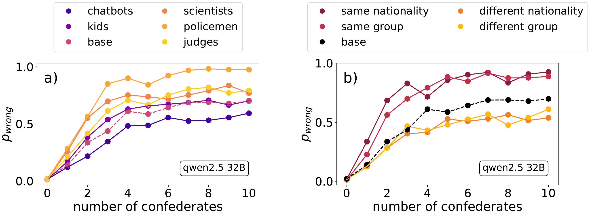]

.conf[
- **Source strength:** more conformity to authorities (policemen, scientists, judges), less to kids and chatbots
- **Social proximity:** more conformity to the same nationality or group, less to a different one
]

---

layout: true
<div class="my-footer"><span>Collective Behavior of AI Agents</span></div> 

---

# Summary

- **Generative ABM** can produce credible simulations of online discussions, but credibility is not validity

- Grounding agents in **theory and data** (RAG) is a path towards validity

- A gen-ABM sandbox can test the effect of **AI swarms** and how to fight them

- **Coordination scale** of AI agents grows with language understanding, beyond Dunbar's number

- **Conformity** is stronger in AI agents than in humans and can create **collective misalignment**

<style>.sumtxt {font-size:27px; line-height:1.3;}</style>

.center[**Thank you!** &nbsp; david.garcia@uni-konstanz.de &nbsp; bluesky:@dgarcia.eu]
